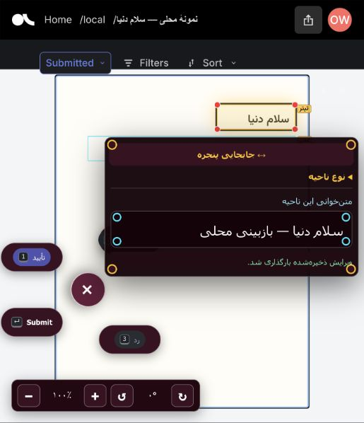

# PersianVLM Local

Run the PersianVLM document annotation editor on your own computer, with Argilla, local accounts, dataset imports, and persistent storage.

## One-line install and launch

Install **Git** and **Docker Desktop** first (or Docker Engine with Compose v2 on Linux). Start Docker, then run in Terminal, Linux shell, or Windows **WSL2**:

```bash
curl -fsSL https://raw.githubusercontent.com/Reza2kn/persianvlm-local/v0.1.0/install.sh | bash
```

Open **http://localhost:6900/local**. The launcher prints a generated username/password and API key. Sign in to Argilla, then return to `/local` to import. Later launches need just:

```bash
~/persianvlm-local/local.sh start
```

First launch downloads container images and builds the companion app. Allow roughly 4 GB RAM and several GB of free disk, plus storage for your datasets. Tested on Apple Silicon macOS with Docker Desktop. Linux and Windows/WSL2 use the same Compose stack but have not been manually tested.

## Import → annotate → export

Try [examples/demo.zip](examples/demo.zip) for a small synthetic Persian page.

1. In the local library, choose a name and upload a **PDF**, an **image**, a **ZIP of images**, or a **ZIP with a JSONL manifest and images**. PDFs are rasterized locally at 144 DPI. Uploads are limited to 512 MiB; split larger books. Importing more datasets never overwrites an existing dataset.
2. Click **Annotate**. Draw/move/resize regions, duplicate or delete boxes, zoom/rotate, edit Persian text, and compare table markup. Region edits save automatically per annotator. Record approval/rejection through Argilla's review controls. Original imported boxes remain available separately.
3. Click **Export ZIP** in the library. The bundle contains dataset settings, embedded images, original boxes, saved local region edits, and Argilla review responses with contributor IDs. Owners/admins can export all contributors; annotators export their own work.

All imported text and boxes start as **unreviewed**. Draft source labels, edits, and submitted reviews remain separate in exports; saving text does not imply human approval.

### JSONL format

Put a `records.jsonl` and relative image files together in a ZIP:

```json
{"id":"page-001","image":"images/page-001.jpg","boxes":[{"x0":40,"y0":60,"x1":600,"y1":120,"label":"Text","text":"سلام دنیا"}]}
```

Coordinates are pixels in the imported image; percentage boxes from PersianVLM exports are also supported by the editor. Existing PersianVLM/Argilla records using `fields.label.src` and `fields.label.items` are accepted. A standalone JSONL upload must embed its images as `data:image/...;base64,...` strings. Original IDs are preserved in `metadata.source_id`; local IDs are namespaced to avoid collisions between datasets.

You can also import a Hugging Face dataset from the library: choose repository/config/split/image column/boxes column and a record limit. This downloads data from Hugging Face; private datasets can use a token for that request. The app does not save the token. Model-generated labels remain unreviewed. The boxes column should contain a list of the same box objects shown above.



## Local operation

```bash
cd ~/persianvlm-local
./local.sh credentials   # show your local login and SDK API key
./local.sh status
./local.sh stop          # data is retained
./local.sh start         # resume
./local.sh logs
./local.sh backup        # database + local edits + credentials
```

Data lives in named Docker volumes. Removing containers or stopping Docker does not delete it. **`docker compose down -v` deletes your datasets and annotations.** Store full backups securely and outside the computer; see [backup and restore](docs/backup.md).

To change the port, edit `LOCAL_PORT` in `.env`, then run `./local.sh start`. To update after reviewing a release, `git fetch --tags` and `git checkout <release-tag>`, then run `./local.sh start`. The installer reuses existing installations without silently updating their code or credentials.

## Scope

- Argilla server and worker **v2.8.0**, PostgreSQL, Elasticsearch, Redis, and a small import/export companion.
- The PersianVLM custom region editor is adapted from the saved September 2026 Hafez-import template. [Provenance](docs/editor-provenance.json) records its source hash. This is a local adaptation of that template; the current production deployment was not accessible for a fresh comparison.
- The base Argilla interface uses its upstream language; region editing controls are Persian. No hosted OAuth account is needed.
- **Manual OCR annotation works locally.** Hosted Bina/Surya/Gemini inference is not bundled; those action buttons are removed. No GPU or paid API is required. Existing table HTML can be viewed/edited.
- Initial installation needs internet. After containers are built and local files imported, annotation and local file imports can run without internet. Hugging Face imports need internet.
- Only `127.0.0.1` is published. This package is intended for a local workstation; LAN/multi-computer hosting needs separate configuration. Argilla can create additional local users and workspace memberships through its SDK/API.

The companion proxies Argilla on the same origin, stores region edits in SQLite per page and user, and checks Argilla credentials and dataset access for every region read/write. It does not import production datasets, users, keys, or services.

## Using the Argilla SDK

Use the API key printed by `./local.sh credentials`:

```python
import argilla as rg
client = rg.Argilla(api_url="http://localhost:6900", api_key="YOUR_LOCAL_API_KEY")
```

Use the browser importer for the PersianVLM editor schema. The normal Argilla SDK remains available for other dataset schemas; see [Argilla's Docker deployment documentation](https://docs.argilla.io/v2.8/getting_started/how-to-deploy-argilla-with-docker/).

## Development and validation

```bash
python -m pip install -r app/requirements.txt
DATA_DIR=$(mktemp -d) python -m unittest discover -s tests -p 'test_*.py'
./local.sh start
python tests/smoke.py
```

The smoke test creates a temporary dataset, imports images and PDF pages, checks authentication, saves/reloads Persian edits, submits a review, checks the exported ZIP, and deletes only the test datasets. See [validation](docs/validation.md) for the tested release scope. An optional [GitHub Actions workflow](docs/github-actions.yml) can be copied to `.github/workflows/test.yml` to run these checks on Ubuntu.

Code is MIT licensed; Argilla and infrastructure components retain their upstream licenses. The bundled Vazirmatn font is under SIL OFL 1.1.
